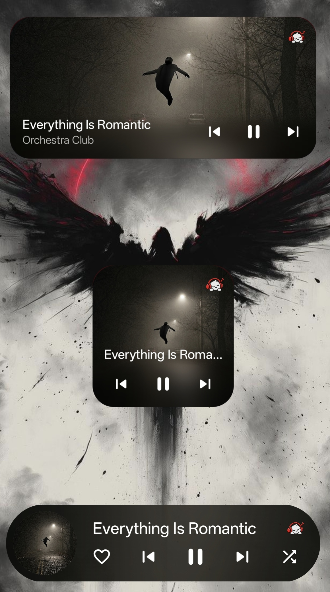

<div align="center">
	

**A beautiful, open-source YouTube Music client for Android** — dynamic theming, word-level synced lyrics, AI lyric translation, DJ Automix, AutoEQ studio calibration, high-quality audio streaming, and real-time listening sessions.

[](https://github.com/nirmaleeswar30/Inzx/releases/latest)
[](https://github.com/nirmaleeswar30/Inzx/releases)
[](https://flutter.dev)
[](#installation)
[](LICENSE)

[Features](#-features) • [Screenshots](#-screenshots) • [Installation](#-installation) • [Build from Source](#-building-from-source) • [Contributing](#-contributing)

</div>

> [!WARNING]
> Inzx is **only** available on the platforms listed in this README. It is **not** on the Play Store or any other site claiming to offer official releases. If we ever publish to additional platforms, it will be announced here. Please avoid unofficial or modified builds for your safety.

<div align="center">

[](https://apps.obtainium.imranr.dev/redirect?r=obtainium://add/https://github.com/nirmaleeswar30/Inzx/)⠀
[](https://github.com/nirmaleeswar30/Inzx/releases/latest)

</div>


## ⚠️ Disclaimer

Inzx is an independent, open-source project. It is **not affiliated with, endorsed by, or sponsored by** Google, YouTube, YouTube Music, JioSaavn, or any of their subsidiaries. We do not host any of our own content we only use publicly available data. All trademarks and content belong to their respective owners. Inzx is provided for personal and educational use — please respect the terms of service of the platforms you access.


## ✨ Highlights

A quick look at what makes Inzx stand out:

- 🎤 **Word-level karaoke lyrics** — syllable-accurate sync from 15+ providers (BetterLyrics, LRCLib, Genius…)
- 🌐 **AI lyric translation** — translate & romanize any script live (OpenRouter · DeepL · Google Gemini)
- 🎚️ **DJ Automix** — smart beatmatching, tempo & transition cues for seamless continuous mixes
- 🎧 **AutoEQ & Studio Calibration** — 4,000+ headphone & IEM compensation profiles + parametric EQ
- 🔊 **Studio-grade audio** — optional JioSaavn source up to 320 kbps with gapless playback & prefetching
- 🎨 **Instant dynamic theming** — 0 ms isolate-extracted album colors, AMOLED black, and liquid-glass UI
- 🖼️ **4 Now Playing styles** — Default, Cinematic, Ripple & OG + waveform / spectrum scrubbers
- 🎞️ **Animated album art (Canvas)** — fullscreen video canvas loops with ambient reflection glow
- 👥 **Jams** — real-time collaborative listening rooms with synchronized queues via Supabase
- 🎮 **Discord Rich Presence** — share your live playback status & album art to Discord
- 📊 **Scrobbling & listening stats** — Last.fm & ListenBrainz support + personalized listening analytics
- 🚗 **Android Auto & widgets** — 3 dynamic home-screen widgets (2×2, 4×1, 4×2) + instant OTA updates

## ❤️ Support Inzx

Inzx is free and open source. If it makes your day a little better, consider supporting development — it keeps the project alive and actively maintained.

<div align="center">

[](https://github.com/sponsors/nirmaleeswar30)

**— or scan to pay via UPI —**


</div>

## 🎯 Features

### 🎧 Playback, Audio & Studio Calibration

- **Dual catalog engines** — YouTube Music via native InnerTube API + optional JioSaavn Lossless/HQ source (up to 320 kbps)
- **DJ Automix** — BitChord beat & vocal analysis engine, BPM & musical key detection, transition cue planning, and seamless beatmatched crossfade
- **AutoEQ calibration** — 4,000+ headphone & IEM compensation profiles (Jaakkopasanen/AutoEq), automatic per-device switching (wired / Bluetooth), bass & tilt dB controls
- **Built-in Equalizer** — multi-band equalizer with bass boost and custom acoustic presets
- **Gapless playback & cache warming** — intelligent stream prefetching for instant zero-buffer track transitions
- **Configurable crossfade** — customizable crossfade duration (Off, 5s, 8s, 10s, 12s)
- **Smart audio routing** — shows active output device (speaker, wired, Bluetooth) with quick-switch controls
- **Prefer audio versions** — automatically skips music video intros and silence
- **Sleep timer** — gentle volume fade-out over customizable durations
- **Robust audio session** — handles phone calls, interruptions, and Bluetooth disconnects cleanly

&nbsp;

### 🎤 Karaoke Lyrics & AI Translation

- **Word-level synced (karaoke) lyrics** — syllable-accurate highlighting powered by BetterLyrics TTML engine
- **15+ providers with smart fallback** — BetterLyrics, LRCLib, Genius, KuGou, Musixmatch, Megalobiz, YouTube captions, embedded ID3 tags, and local files
- **Live AI translation & transliteration** — translate and romanize foreign scripts in real-time via OpenRouter, DeepL, or Google Gemini
- **Fine offset calibration** — adjust line and word timing offsets with persistent per-track calibration
- **Vocals & instrumental detection** — background vocal separation, lead singer markers, and instrumental gap indicators

&nbsp;

### 🎨 Interface & Now Playing

- **Instant dynamic colors** — isolate-based `AlbumColorExtractor` generates 0 ms palettes from album covers with zero UI stutter
- **Shader-powered liquid-glass UI** — translucent navigation bar with real-time blur and specular highlight shaders
- **4 distinct Now Playing styles** — Default, Cinematic, Ripple, and classic OG layouts
- **Audio visualizer progress bars** — linear, dynamic waveform, and live frequency spectrum scrubbers
- **Animated album art (Canvas)** — fullscreen video canvas loops with ambient reflection glow
- **Material 3 personalization** — 10+ brand accent colors (including new Inzx Purple), custom color wheel, and pure AMOLED dark mode
- **Skeletonizer shimmer** — fluid loading placeholders across all views
- **Localized UI** in 20+ languages with catalog-region control

&nbsp;

### 👥 Jams, Discord & Social Presence

- **Real-time Jams** — collaborative listening rooms powered by Supabase WebSockets with millisecond drift correction
- **Collaborative queue** — shared queue where friends can add, reorder, or vote on tracks in real time
- **Host & participant permissions** — fine-grained control with "last controller wins" conflict resolution
- **Discord Rich Presence** — live Discord activity showing track title, artist, album art, elapsed time, and "Listen on Inzx"
- **Scrobbling support** — native Last.fm and ListenBrainz integration with standard scrobble thresholds (50% or 3 min)
- **Personal listening statistics** — in-depth stats tracking top tracks, most played artists, and total listening time

&nbsp;

### 📚 Library, Discovery & Offline

- **YouTube Music account sync** — Google Sign-In with bidirectional sync for playlists, liked tracks, saved albums, subscribed artists, and history
- **Guest / Private mode** — full streaming and discovery without altering your Google account history
- **Playlist importer** — import external playlists from YouTube Music with one tap
- **Download manager** — multi-threaded background downloader for offline listening
- **Local file player & tag editor** — browse local folders and edit ID3, MP4, and WebM tags directly
- **Moods & Genres browsing** — curated mood feeds, genre charts, artist radios, and related track discovery

&nbsp;

### 📱 Platform, Widgets & Updates

- **Android Auto integration** — driving-optimized dashboard interface for safe on-road playback
- **Dynamic home-screen widgets** — 3 launcher widget formats (2×2, 4×1 compact, 4×2 expanded) updating live via Android AppWidgetProvider
- **Instant OTA updates** — Shorebird code push delivers patches instantly without reinstalling APKs
- **In-app GitHub release notifications** — checks for major releases with direct APK downloads
- **Backup & restore** — export and restore your entire app state, playlists, favorites, and settings to a single file
- **Deep links & sharing** — native sharing for tracks, albums, and playlists

&nbsp;

### 🔒 Privacy & Open Source

- **Offline-first architecture** — core features work entirely without an internet connection or login
- **Encrypted credentials** — auth tokens and API keys stored securely via Android Keystore
- **Zero tracking or analytics** — completely free, no telemetry, no third-party tracking, no ads

---

## 📸 Screenshots

<div align="center">

| **Home** | **Now Playing** | **Library** | **Jams** |
|:---:|:---:|:---:|:---:|
|  | <video src="./.github/screenshots/nowplaying.mp4" controls autoplay loop muted playsinline width="100%"><a href="./.github/screenshots/nowplaying.mp4">▶ **Play Video**</a></video> |  |  |
| **Search** | **Playlist** | **Folders** | **Lyrics** |
|  |  |  |  |

</div>

<table width="100%">
<tr><th align="center">Word-Level Synced Lyrics</th></tr>
<tr><td align="center"></td></tr>
</table>

<div align="center">

| **Home Screen Widgets** |
|:---:|
|  |

| **Android Auto** | **Android Auto — Now Playing** |
|:---:|:---:|
|  |  |

</div>

---

## 📥 Installation

Inzx supports **Android**. Grab the latest APK one of two ways:

- **Obtainium** (recommended) — auto-updates directly from GitHub releases. Use the badge above or add this repo:
  `https://github.com/nirmaleeswar30/Inzx`
- **GitHub Releases** — download the APK from the [latest release](https://github.com/nirmaleeswar30/Inzx/releases/latest).

Once installed, Inzx delivers smaller patches automatically via over-the-air (OTA) updates, so you stay current without reinstalling.

<details>
<summary>Install via ADB</summary>

```bash
adb install app-release.apk
```
</details>

---

## 🛠️ Building from Source

### Prerequisites
- **Flutter SDK** (stable channel, bundling **Dart**)
- **Android Studio** or **VS Code** with the Flutter/Dart extensions
- **Android SDK** and **Git**

### Setup

1. **Clone the repository**
   ```bash
   git clone https://github.com/nirmaleeswar30/Inzx.git
   cd Inzx
   ```

2. **Install dependencies**
   ```bash
   flutter pub get
   ```

3. **Run code generation**
   ```bash
   dart run build_runner build --delete-conflicting-outputs
   flutter gen-l10n
   ```

4. **Configure environment variables** — copy the example and fill in the values:
   ```bash
   cp .env.example .env
   ```
   | Variable | Purpose |
   |---|---|
   | `SUPABASE_URL` / `SUPABASE_ANON_KEY` | Real-time backend for **Jams** |
   | `GOOGLE_WEB_CLIENT_ID` | Google Sign-In for Jam profiles |
   | `GITHUB_RELEASE_REPO` | Repo checked for GitHub release updates |

   > Jams and Google Sign-In are optional — the rest of the app builds and runs without them.

5. **(Optional) Configure Supabase** for Jams — create a project at [supabase.com](https://supabase.com), enable Realtime, and paste the URL and anon key into `.env`.

6. **(Optional) Configure Google Sign-In** — create an OAuth 2.0 Web Client ID in the Google Cloud Console and set `GOOGLE_WEB_CLIENT_ID`.

### Build Commands

```bash
# Debug run
flutter run

# Release APK
flutter build apk --release

# Split APKs per ABI (smaller downloads)
flutter build apk --split-per-abi --release
```

---

## 🏗️ Architecture & Tech Stack

**Core** — Flutter · Dart · [Riverpod](https://riverpod.dev) (state management)

**Data & storage** — [Hive](https://pub.dev/packages/hive) (fast local cache for tracks, playlists & colors) · Flutter Secure Storage (encrypted credentials) · Shared Preferences (settings) · [Supabase](https://supabase.com) (real-time Jams backend)

**Audio & catalog** — Custom **InnerTube API** engine · [just_audio](https://pub.dev/packages/just_audio) · [audio_service](https://pub.dev/packages/audio_service) · [audio_session](https://pub.dev/packages/audio_session) · JioSaavn HQ source · [BitChord](https://github.com/kushagrasinghx/BitChord) Automix engine (BPM, key & beat transition analysis) · [AutoEQ](https://github.com/jaakkopasanen/AutoEq) database (4,000+ headphone calibration profiles)

**Social & integrations** — Discord Rich Presence (RPC) · Last.fm & ListenBrainz scrobbling clients · BetterLyrics TTML parser

**UI & media** — Custom liquid-glass shaders · [Skeletonizer](https://pub.dev/packages/skeletonizer) · isolate-based `AlbumColorExtractor` (0 ms palette) · [Iconsax](https://pub.dev/packages/iconsax) · Cached Network Image · `video_player` (Spotify Canvas art) · Marquee

**Delivery** — [Shorebird](https://shorebird.dev) code push for OTA updates

---

## 🌍 Localization

Inzx ships a fully localized UI and locale-aware YouTube Music content requests in **20+ languages**:

English · Arabic · German · Spanish · French · Hindi · Indonesian · Japanese · Kannada · Korean · Malayalam · Portuguese · Portuguese (Brazil) · Russian · Tamil · Telugu · Thai · Turkish · Ukrainian · Simplified Chinese · Traditional Chinese

Translations live in [`lib/l10n`](lib/l10n). Contributions and corrections are very welcome — see [Contributing](#-contributing).

---

## 🗺️ Roadmap

- [x] Word-level synced lyrics (BetterLyrics TTML engine)
- [x] AI lyric translation & transliteration (Gemini / DeepL / OpenRouter)
- [x] JioSaavn high-quality 320 kbps audio source
- [x] DJ Automix with beatmatching & transition analysis
- [x] AutoEQ headphone calibration (4,000+ profiles) & Equalizer
- [x] Discord Rich Presence & Last.fm / ListenBrainz scrobbling
- [x] Real-time collaborative Jams
- [x] Crossfade & gapless prefetching
- [x] Android Auto dashboard integration
- [x] Dynamic home-screen widgets (2×2, 4×1, 4×2)
- [x] Multiple Now Playing & progress-bar styles (Waveform / Spectrum)
- [x] Over-the-air updates (Shorebird)
- [ ] Google Cast / Chromecast audio streaming
- [ ] Desktop targets (Windows · macOS · Linux)

---

## 🤝 Contributing

Contributions are welcome! Bug reports, feature ideas, translations and pull requests all help.

1. Fork the repo and create a branch off `main`.
2. Make your changes and run `flutter analyze` (keep it clean).
3. Open a pull request describing what and why.

For larger features, please open an issue first so we can align on the approach.

---

## 🙏 Acknowledgments

- [OuterTune](https://github.com/OuterTune/OuterTune) & [InnerTune](https://github.com/z-huang/InnerTune) — design and architecture inspiration
- [BetterLyrics](https://github.com/boidushya/better-lyrics) — word-level synced lyrics
- [LRCLib](https://lrclib.net) — open synced-lyrics database
- [AutoEq](https://github.com/jaakkopasanen/AutoEq) — headphone & earphone compensation frequency response database
- [Metrolist](https://github.com/metrolistgroup/metrolist) — Kotlin based ytm client
- [Bitchord](https://github.com/kushagrasinghx/BitChord) — another kotlin ytm client built on top of metrolist
- [just_audio](https://pub.dev/packages/just_audio) — audio playback engine
- [Supabase](https://supabase.com) — real-time infrastructure
- [Shorebird](https://shorebird.dev) — Flutter over-the-air updates
- [Flutter](https://flutter.dev) — UI framework

---

## ⭐ Star History

<a href="https://star-history.com/#nirmaleeswar30/Inzx&Date">
  <picture>
    <source media="(prefers-color-scheme: dark)" srcset="https://api.star-history.com/svg?repos=nirmaleeswar30/Inzx&type=Date&theme=dark" />
    <source media="(prefers-color-scheme: light)" srcset="https://api.star-history.com/svg?repos=nirmaleeswar30/Inzx&type=Date" />
    
  </picture>
</a>

---

## 📄 License

Released under the [GNU General Public License v3.0](LICENSE).

