<div align="center">
	

**A beautiful, open-source YouTube Music client for Android, iOS (beta), Windows & Linux** — dynamic theming, word-level synced lyrics, AI lyric translation, DJ Automix, AutoEQ studio calibration, high-quality audio streaming, Inzx Connect multi-device sync, and real-time listening sessions.

[](https://github.com/nirmaleeswar30/Inzx/releases/latest)
[](https://github.com/nirmaleeswar30/Inzx/releases)
[](https://flutter.dev)
[](#installation)
[](LICENSE)

[Website](https://inzx.nirmaleeswar.dev/) • [Features](#-features) • [Screenshots](#-screenshots) • [Installation](#-installation) • [Build from Source](#-building-from-source) • [Contributing](#-contributing)

</div>

> [!WARNING]
> Inzx is **only** available on the platforms listed in this README. It is **not** on the Play Store or any other site claiming to offer official releases. If we ever publish to additional platforms, it will be announced here. Please avoid unofficial or modified builds for your safety.

<div align="center">

[](https://apps.obtainium.imranr.dev/redirect?r=obtainium://add/https://github.com/nirmaleeswar30/Inzx/)⠀
[](https://github.com/nirmaleeswar30/Inzx/releases/latest)

</div>


## ⚠️ Disclaimer

Inzx is an independent, open-source project. It is **not affiliated with, endorsed by, or sponsored by** Google, YouTube, YouTube Music, JioSaavn, or any of their subsidiaries. We do not host any of our own content we only use publicly available data. All trademarks and content belong to their respective owners. Inzx is provided for personal and educational use — please respect the terms of service of the platforms you access.


## ✨ Highlights

A quick look at what makes Inzx stand out:

- 🎤 **Word-level karaoke lyrics** — syllable-accurate sync from 15+ providers (BetterLyrics, LRCLib, Genius…)
- 🌐 **AI lyric translation** — translate & romanize any script live (OpenRouter · DeepL · Google Gemini)
- 🎚️ **DJ Automix** — smart beatmatching, tempo & transition cues for seamless continuous mixes
- 🎧 **AutoEQ & Studio Calibration** — 4,000+ headphone & IEM compensation profiles + parametric EQ
- 🔊 **Studio-grade audio** — optional JioSaavn source up to 320 kbps with gapless playback & prefetching
- 🔗 **Inzx Connect** — multi-device bidirectional queue & playback sync, remote control, and simultaneous playback
- 🖥️ **Native Desktop apps** — Windows installer (.exe) & Linux AppImage with global media keys and background self-update
- 🍎 **iPhone & iPad beta** — sideloaded IPA, Home Screen widgets, AAC playback, lossless add-ons, AutoEQ, and live Automix blends
- 🧭 **Explore on mobile** — charts, new releases, moods, genres, and music videos replace the Songs tab on Android and iOS
- 🎨 **Instant dynamic theming** — 0 ms isolate-extracted album colors, AMOLED black, and liquid-glass UI
- 🖼️ **4 Now Playing styles** — Default, Cinematic, Ripple & OG + waveform / spectrum scrubbers
- 🎞️ **Animated album art (Canvas)** — fullscreen video canvas loops with ambient reflection glow
- 👥 **Jams** — real-time collaborative listening rooms with synchronized queues via Supabase
- 🎮 **Discord Rich Presence** — share your live playback status & album art to Discord
- 📊 **Scrobbling & listening stats** — Last.fm & ListenBrainz support + personalized listening analytics
- 🚗 **Android Auto, widgets & desktop** — 3 dynamic home-screen widgets + MPRIS / SMTC media controls + Shorebird OTA updates

## ❤️ Support Inzx

Inzx is free and open source. If it makes your day a little better, consider supporting development — it keeps the project alive and actively maintained.

<div align="center">

[](https://github.com/sponsors/nirmaleeswar30)

**— or scan to pay via UPI —**


</div>

## 🎯 Features

### 🎧 Playback, Audio & Studio Calibration

- **Dual catalog engines** — YouTube Music via native InnerTube API + optional JioSaavn Lossless/HQ source (up to 320 kbps)
- **DJ Automix** — BitChord beat & vocal analysis engine, BPM & musical key detection, transition cue planning, and seamless beatmatched crossfade
- **AutoEQ calibration** — 4,000+ headphone & IEM compensation profiles (Jaakkopasanen/AutoEq), automatic per-device switching (wired / Bluetooth), bass & tilt dB controls
- **Built-in Equalizer** — multi-band equalizer with bass boost and custom acoustic presets
- **Gapless playback & cache warming** — intelligent stream prefetching for instant zero-buffer track transitions
- **Configurable crossfade** — customizable crossfade duration (Off, 5s, 8s, 10s, 12s)
- **Smart audio routing** — shows active output device (speaker, wired, Bluetooth) with quick-switch controls
- **Prefer audio versions** — automatically skips music video intros and silence
- **Sleep timer** — gentle volume fade-out over customizable durations
- **Robust audio session** — handles phone calls, interruptions, and Bluetooth disconnects cleanly

&nbsp;

### 🎤 Karaoke Lyrics & AI Translation

- **Word-level synced (karaoke) lyrics** — syllable-accurate highlighting powered by BetterLyrics TTML engine
- **15+ providers with smart fallback** — BetterLyrics, LRCLib, Genius, KuGou, Musixmatch, Megalobiz, YouTube captions, embedded ID3 tags, and local files
- **Live AI translation & transliteration** — translate and romanize foreign scripts in real-time via OpenRouter, DeepL, or Google Gemini
- **Fine offset calibration** — adjust line and word timing offsets with persistent per-track calibration
- **Vocals & instrumental detection** — background vocal separation, lead singer markers, and instrumental gap indicators

&nbsp;

### 🎨 Interface & Now Playing

- **Instant dynamic colors** — isolate-based `AlbumColorExtractor` generates 0 ms palettes from album covers with zero UI stutter
- **Shader-powered liquid-glass UI** — translucent navigation bar with real-time blur and specular highlight shaders; as you scroll it folds its labels away and tightens, and the mini player shrinks with it
- **4 distinct Now Playing styles** — Default, Cinematic, Ripple, and classic OG layouts
- **Audio visualizer progress bars** — linear, dynamic waveform, and live frequency spectrum scrubbers
- **Animated album art (Canvas)** — fullscreen video canvas loops with ambient reflection glow
- **3D cover on desktop** — on Windows and Linux, the album art in Now Playing and full-screen lyrics leans towards the mouse
- **Material 3 personalization** — 10+ brand accent colors (including new Inzx Purple), custom color wheel, and pure AMOLED dark mode
- **Skeletonizer shimmer** — fluid loading placeholders across all views
- **Localized UI** in 20+ languages with catalog-region control

&nbsp;

### 👥 Jams, Discord & Social Presence

- **Real-time Jams** — collaborative listening rooms powered by Supabase WebSockets with millisecond drift correction
- **Collaborative queue** — shared queue where friends can add, reorder, or vote on tracks in real time
- **Host & participant permissions** — fine-grained control with "last controller wins" conflict resolution
- **Discord Rich Presence** — live Discord activity showing track title, artist, album art, elapsed time, and "Listen on Inzx"
- **Scrobbling support** — native Last.fm and ListenBrainz integration with standard scrobble thresholds (50% or 3 min)
- **Personal listening statistics** — in-depth stats tracking top tracks, most played artists, and total listening time

&nbsp;

### 🔗 Inzx Connect & Multi-Device Sync

- **Bidirectional playback sync** — seamlessly sync active playback, state, and queues across Android, iPhone, iPad, Windows, and Linux
- **Device pairing via Supabase** — quick device discovery and pairing with instant connection status
- **Simultaneous playback** — synchronized multi-room / multi-device playback across paired installations
- **Remote control** — control volume, skip, pause, and reorder upcoming tracks from any linked device
- **Desktop follows your phone** — while nothing is playing on the PC, its player bar shows the song playing on a paired phone and controls it; **Play here** moves the song to the PC

&nbsp;

### 📚 Library, Discovery & Offline

- **YouTube Music account sync** — Google Sign-In with bidirectional sync for playlists, liked tracks, saved albums, subscribed artists, and history
- **Guest / Private mode** — full streaming and discovery without altering your Google account history
- **Playlist importer** — import external playlists from YouTube Music with one tap
- **Download manager** — multi-threaded background downloader for offline listening
- **Local file player & tag editor** — browse local folders and edit ID3, MP4, and WebM tags directly
- **Moods & Genres browsing** — curated mood feeds, genre charts, artist radios, and related track discovery
- **Explore tab on Android & iOS** — charts, new releases, music videos, moods, and genres in a layout adapted for phones; local music remains in Folders

&nbsp;

### 📱 Platform, Desktop, Widgets & Updates

- **iPhone & iPad (iOS 17+)** — sideload through AltStore, SideStore, or Sideloadly; native audio effects, Files folder access, Keychain storage, and small/medium Home Screen widgets with playback controls
- **iOS Automix** — live beatmatched blends with progress-bar feedback; loop-mix transitions fall back to live blends on iOS
- **Dolby Atmos add-on playback** — turn on **Prefer Dolby Atmos mixes** in **Settings → Audio** to play compatible add-on mixes on supported outputs.
- **Native Windows Desktop** — per-user installer (`.exe`) packaged with Inno Setup, system tray / taskbar controls, and silent background self-updates
- **Linux AppImage** — standalone portable AppImage with bundled `libmpv`, desktop launcher menu integration, and MPRIS media keys
- **Desktop mini player** — shrink the window to a small always-on-top player with artwork (including animated canvases), synced lyrics, and hover controls. On Hyprland, Inzx floats and resizes its own window; other Linux desktops depend on the compositor. See [Linux mini player](docs/linux-miniplayer.md)
- **Hardware media keys & transport** — Windows SMTC and Linux MPRIS integration for keyboard keys, headsets, and system media widgets
- **Android Auto integration** — driving-optimized dashboard interface for safe on-road playback
- **Dynamic home-screen widgets** — 3 launcher widget formats (2×2, 4×1 compact, 4×2 expanded) updating live via Android AppWidgetProvider
- **Over-the-air updates (Shorebird)** — code push across Android, iOS, Windows, and Linux when installed from a Shorebird baseline; standard Flutter builds require a new binary
- **In-app GitHub release notifications** — checks for major releases with direct installer / APK downloads
- **Backup & restore** — export and restore your entire app state, playlists, favorites, and settings to a single file
- **Deep links & sharing** — native sharing for tracks, albums, and playlists

&nbsp;

### 🔒 Privacy & Open Source

- **Offline-first architecture** — core features work entirely without an internet connection or login
- **Protected credentials** — system secure storage, including Android Keystore and iOS Keychain; Linux falls back to a private per-user file when no keyring is available
- **Zero tracking or analytics** — completely free, no telemetry, no third-party tracking, no ads

---

## 📸 Screenshots

<div align="center">

| **Home** | **Now Playing** | **Library** | **Jams** |
|:---:|:---:|:---:|:---:|
| 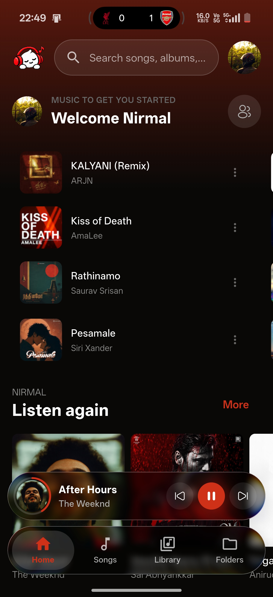 | 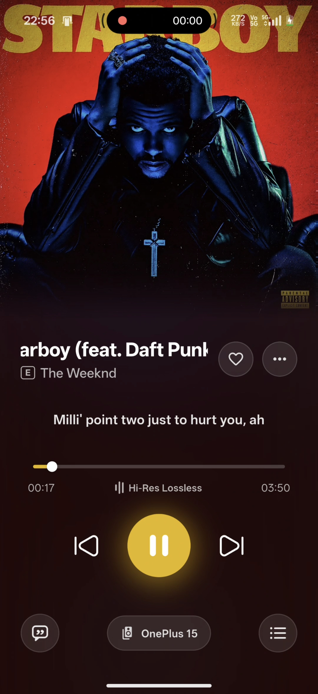 | 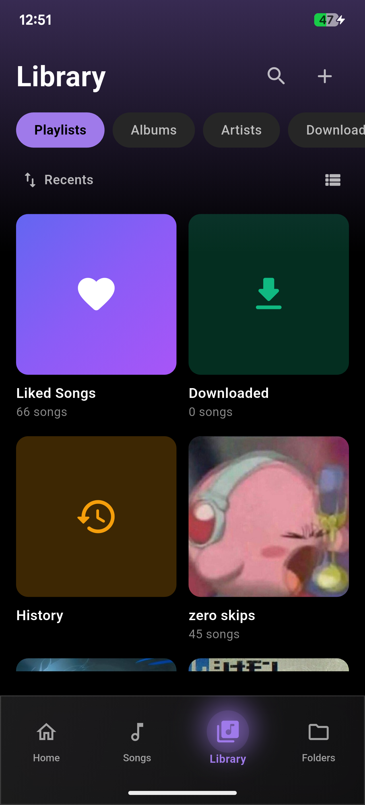 | 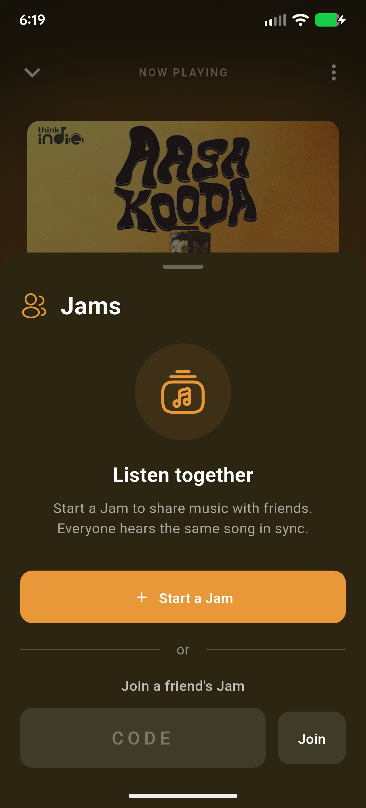 |
| **Search** | **Playlist** | **Folders** | **Lyrics** |
| 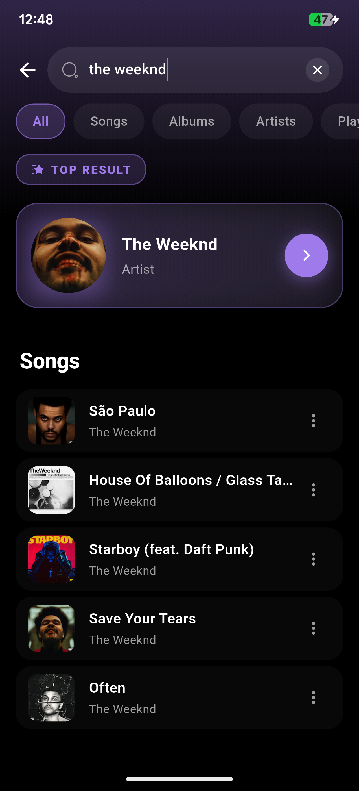 | 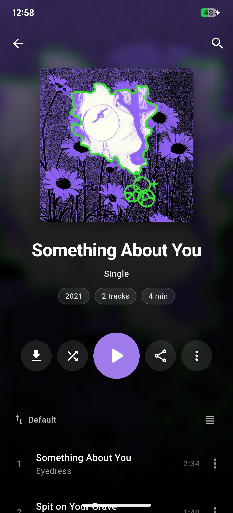 | 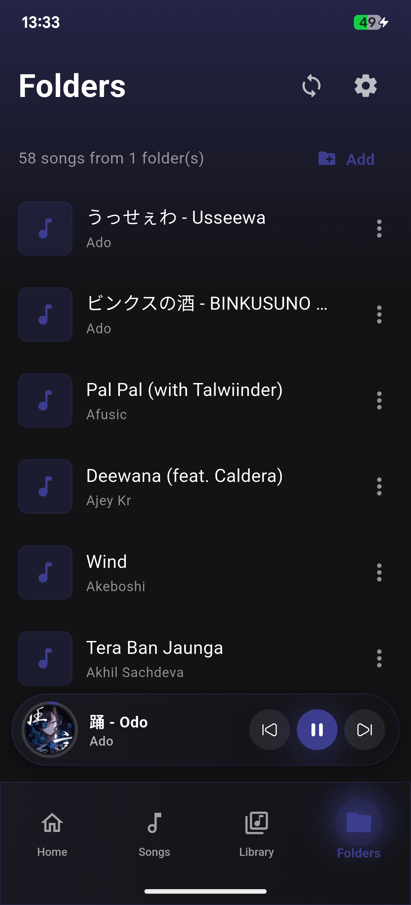 | 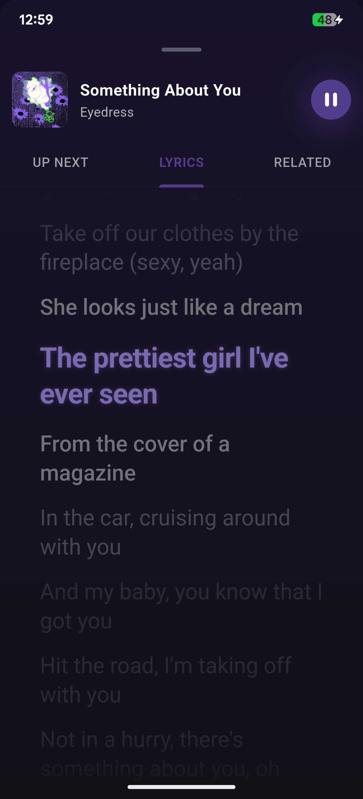 |

</div>

<table width="100%">
<tr><th align="center">Word-Level Synced Lyrics</th></tr>
<tr><td align="center">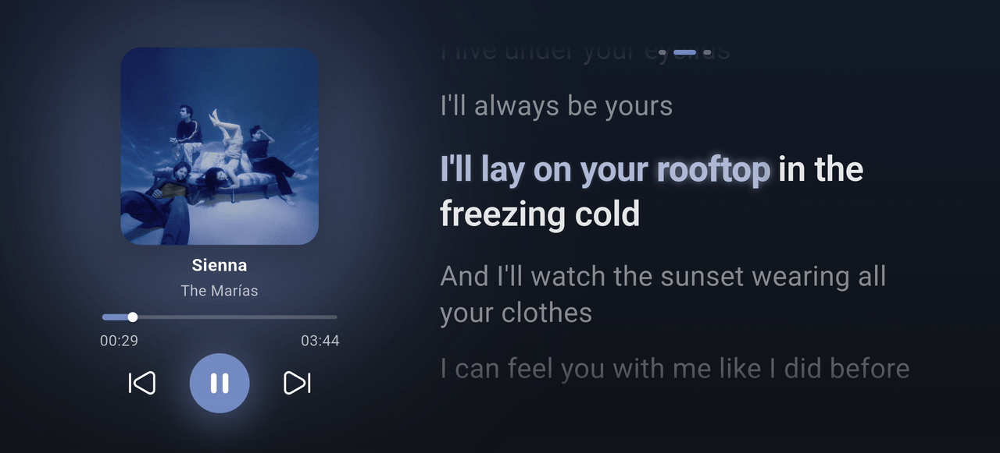</td></tr>
</table>

<div align="center">

| **Home Screen Widgets** |
|:---:|
| 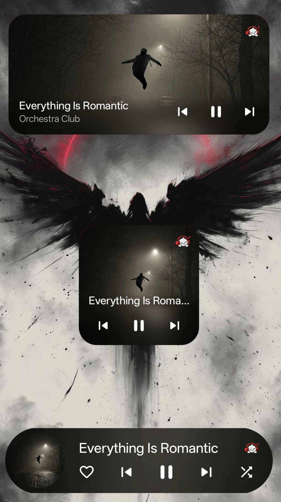 |

| **Share Song Card** | **Share Lyrics Card** |
|:---:|:---:|
| 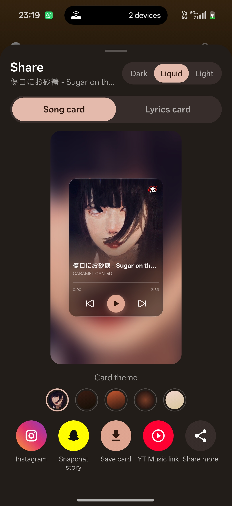 | 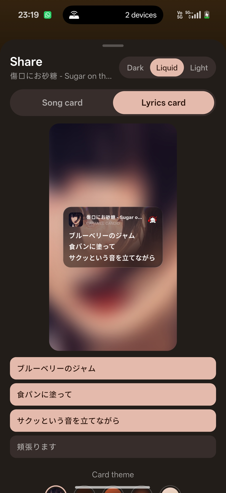 |

| **Android Auto** | **Android Auto — Now Playing** |
|:---:|:---:|
| 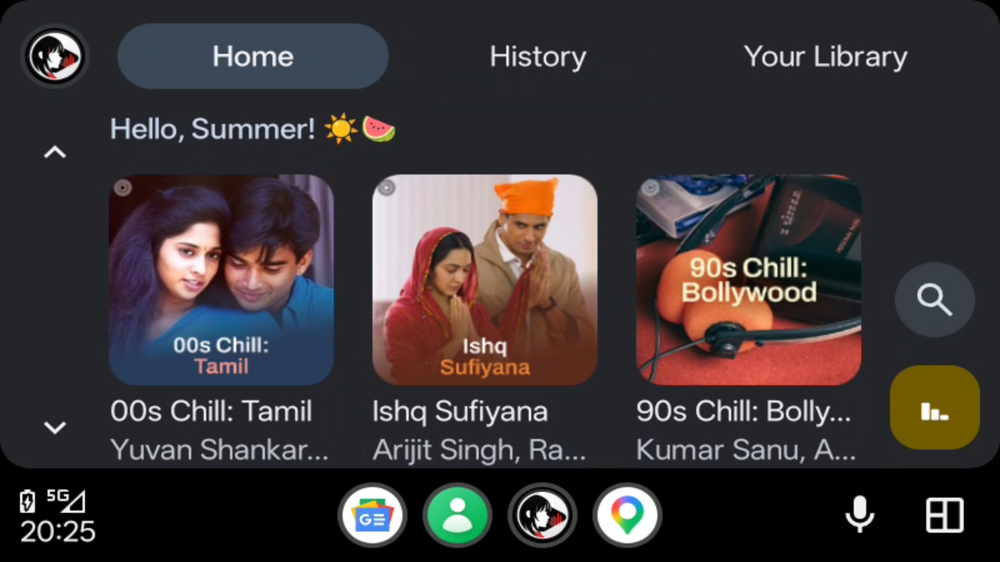 | 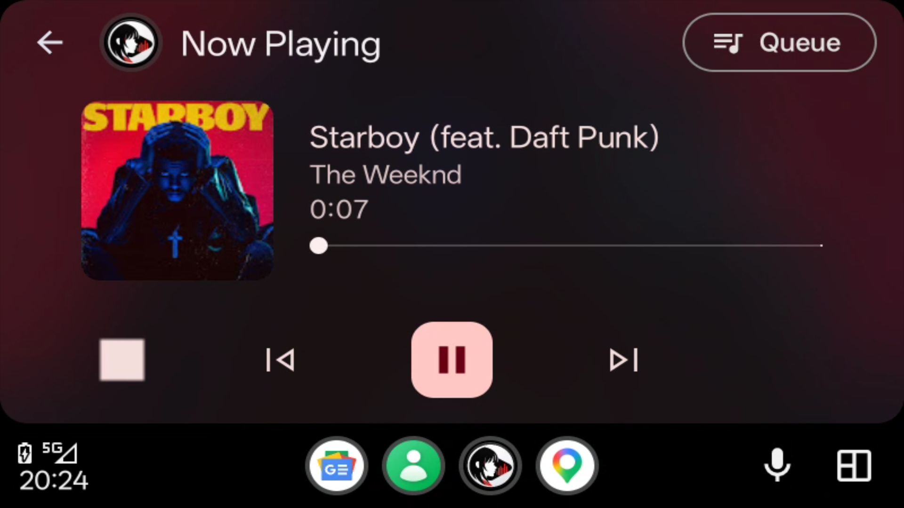 |

</div>

---

## 📥 Installation

Inzx is officially supported on **Android**, **iOS** (beta), **Windows**, and **Linux**.

### 📱 Android
Grab the latest APK one of two ways:

- **Obtainium** (recommended) — auto-updates directly from GitHub releases. Use the badge above or add this repo:
  `https://github.com/nirmaleeswar30/Inzx`
- **GitHub Releases** — download the APK (`inzx.apk` or `inzx-universal.apk`) from the [latest release](https://github.com/nirmaleeswar30/Inzx/releases/latest).

<details>
<summary>Install via ADB</summary>

```bash
adb install app-release.apk
```
</details>

### 🍎 iOS (beta)
Inzx for iPhone and iPad (iOS 17 or later) is a sideloaded app; it isn't on the App Store.

- **AltStore / SideStore** (recommended) — add the source `https://inzx.nirmaleeswar.dev/altstore.json`, then install Inzx from it. Updates arrive through the source.
- **Sideloadly / other tools** — download **`Inzx-<version>-<build>.ipa`** from a [GitHub release containing an IPA](https://github.com/nirmaleeswar30/Inzx/releases) and install it with your Apple ID. Until an IPA is published, maintainers can build one through the manual iOS workflow below.

With a free Apple ID, sideloaded apps must be refreshed every 7 days (AltStore and SideStore do it in the background).

<details>
<summary>What's different on iOS</summary>

- YouTube streams and downloads are AAC; lossless add-ons support FLAC/ALAC files and compatible DASH streams through a fragmented-MP4 bridge. Opus/WebM streams are skipped on iOS.
- Your own music: put files in **Files → On My iPhone → Inzx → Music**, or add any folder from Files.
- No hi-res/bit-perfect switch (iOS mixes all audio itself), no CarPlay yet, and Jams keep syncing only while music plays or the app is open.
</details>

### 🪟 Windows
1. Download **`Inzx-Setup-<version>.exe`** from the [latest release](https://github.com/nirmaleeswar30/Inzx/releases/latest).
2. Run the installer. It installs per-user into `%LOCALAPPDATA%\Programs\Inzx` without requiring administrator privileges.
3. Once installed, Inzx automatically updates in the background when updates are released.

### 🐧 Linux
1. Download **`Inzx-<version>-x86_64.AppImage`** from the [latest release](https://github.com/nirmaleeswar30/Inzx/releases/latest).
2. Make it executable and run:
   ```bash
   chmod +x Inzx-*-x86_64.AppImage
   ./Inzx-*-x86_64.AppImage
   ```
3. On first launch, Inzx can automatically integrate into your application launcher menu.

---

## 🛠️ Building from Source

### Prerequisites
- **Flutter SDK 3.50 or newer** (stable channel, bundling **Dart**)
- **JDK 17 or newer** (for Android builds, which use Android Gradle Plugin 9)
- **Android Studio** or **VS Code** with Flutter/Dart extensions
- **Visual Studio with C++ tools** (for Windows builds)
- **libmpv** & standard build tools (for Linux builds: `libmpv-dev clang cmake ninja-build`)
- **macOS, Xcode & CocoaPods** (for local iOS builds; the manual GitHub Actions workflow can build an IPA from any development platform)
- **Git**

### Setup

1. **Clone the repository**
   ```bash
   git clone https://github.com/nirmaleeswar30/Inzx.git
   cd Inzx
   ```

2. **Install dependencies**
   ```bash
   flutter pub get
   ```

3. **Run code generation**
   ```bash
   dart run build_runner build
   flutter gen-l10n
   ```

4. **Configure environment variables** — copy the example and fill in the values:
   ```bash
   cp .env.example .env
   ```
   | Variable | Purpose |
   |---|---|
   | `SUPABASE_URL` / `SUPABASE_ANON_KEY` | Backend for **Jams** and **Inzx Connect** |
   | `GOOGLE_WEB_CLIENT_ID` | Google Sign-In for Jam profiles |
   | `GITHUB_RELEASE_REPO` | Repo checked for GitHub release updates |

   > Jams and Google Sign-In are optional — the rest of the app builds and runs without them.

5. **(Optional) Configure Supabase** for Jams — create a project at [supabase.com](https://supabase.com), enable Realtime, and paste the URL and anon key into `.env`.

6. **(Optional) Configure Google Sign-In** — create an OAuth 2.0 Web Client ID in the Google Cloud Console and set `GOOGLE_WEB_CLIENT_ID`.

7. **(Optional) Enable Inzx Connect** — apply the [pairing migration](supabase/migrations/20261111000100_inzx_connect_pairing.sql) to the configured Supabase project and enable anonymous sign-ins in Supabase Auth. Open **Settings → Inzx Connect** to pair Android, iOS, and desktop devices. Each installation creates its device session automatically.

### Build Commands

```bash
# Debug run
flutter run

# --- Android ---
# Release APK (ARM64-v8a)
flutter build apk --release

# Split APKs per ABI (smaller downloads)
flutter build apk --split-per-abi --release

# --- iOS (macOS only) ---
ruby ios/scripts/configure_xcode.rb
flutter build ios --release --no-codesign
bash scripts/ios/make_ipa.sh

# --- Windows Desktop ---
# Standard Windows Release installer
.\scripts\package_windows_installer.ps1 -BuildType normal

# Shorebird OTA-enabled Windows Release installer
.\scripts\package_windows_installer.ps1 -BuildType shorebird

# --- Linux Desktop ---
# Standard Linux AppImage
bash scripts/build_appimage.sh normal

# Shorebird OTA-enabled Linux AppImage
bash scripts/build_appimage.sh shorebird
```

The first Windows or Linux build downloads ONNX Runtime 1.28.0 for desktop Automix from Microsoft's NuGet package (about 140 MB, checksum-verified) and reuses it afterwards.

### Manual iOS builds

Open **Actions → iOS build → Run workflow**, choose **normal** or **shorebird**, and enter a positive iOS build number. Pushes, pull requests, and published releases do not start this workflow.

- **normal** builds a standard Flutter IPA without OTA support.
- **shorebird** runs from `main`, requires the `SHOREBIRD_TOKEN` repository secret, and registers an OTA baseline. Increment the build number for each new baseline. As in Nivio, the workflow reuses an existing release's Flutter revision and packages the exact Shorebird archive.
- **ENV_FILE** must contain the full app `.env` for either option. CI fails if it is missing and verifies that the packaged IPA contains exactly that file.
- Download **inzx-ios-normal** or **inzx-ios-shorebird** from the run's artifacts. Each includes the sideloadable IPA, checksums, dependency locks, and toolchain details. To publish the IPA through the AltStore source, attach it to a GitHub release separately.

See [iOS build notes](ios/README.md) and [Shorebird setup](SHOREBIRD_SETUP.md) for local builds and patching.

---

## 🏗️ Architecture & Tech Stack

**Core** — Flutter · Dart · [Riverpod](https://riverpod.dev) (state management)

**Data & storage** — [Hive](https://pub.dev/packages/hive) (fast local cache for tracks, playlists & colors) · Flutter Secure Storage (encrypted credentials) · Shared Preferences (settings) · [Supabase](https://supabase.com) (real-time Jams backend)

**Audio & catalog** — Custom **InnerTube API** engine · [just_audio](https://pub.dev/packages/just_audio) · [audio_service](https://pub.dev/packages/audio_service) · [audio_session](https://pub.dev/packages/audio_session) · JioSaavn HQ source · [BitChord](https://github.com/kushagrasinghx/BitChord) Automix engine (BPM, key & beat transition analysis) · [AutoEQ](https://github.com/jaakkopasanen/AutoEq) database (4,000+ headphone calibration profiles)

**Social & integrations** — Discord Rich Presence (RPC) · Last.fm & ListenBrainz scrobbling clients · BetterLyrics TTML parser

**UI & media** — [Inter](https://rsms.me/inter/) typeface · Custom liquid-glass shaders · [Skeletonizer](https://pub.dev/packages/skeletonizer) · isolate-based `AlbumColorExtractor` (0 ms palette) · [Iconsax](https://pub.dev/packages/iconsax) · Cached Network Image · `video_player` (Spotify Canvas art) · Marquee

**Delivery** — [Shorebird](https://shorebird.dev) code push for OTA updates

---

## 🌍 Localization

Inzx ships a fully localized UI and locale-aware YouTube Music content requests in **20+ languages**:

English · Arabic · German · Spanish · French · Hindi · Indonesian · Japanese · Kannada · Korean · Malayalam · Portuguese · Portuguese (Brazil) · Russian · Tamil · Telugu · Thai · Turkish · Ukrainian · Simplified Chinese · Traditional Chinese

Translations live in [`lib/l10n`](lib/l10n). Contributions and corrections are very welcome — see [Contributing](#-contributing).

---

## 🗺️ Roadmap

- [x] Word-level synced lyrics (BetterLyrics TTML engine)
- [x] AI lyric translation & transliteration (Gemini / DeepL / OpenRouter)
- [x] JioSaavn high-quality 320 kbps audio source
- [x] DJ Automix with beatmatching & transition analysis
- [x] AutoEQ headphone calibration (4,000+ profiles) & Equalizer
- [x] Discord Rich Presence & Last.fm / ListenBrainz scrobbling
- [x] Real-time collaborative Jams
- [x] Inzx Connect (multi-device bidirectional sync & simultaneous playback)
- [x] Personal listening statistics & analytics
- [x] Crossfade & gapless prefetching
- [x] Android Auto dashboard integration
- [x] Dynamic home-screen widgets (2×2, 4×1, 4×2)
- [x] Multiple Now Playing & progress-bar styles (Waveform / Spectrum)
- [x] Native Desktop targets (Windows installer · Linux AppImage)
- [x] iPhone & iPad beta (sideloading, widgets, AutoEQ & Automix)
- [x] Explore tab on Android & iOS
- [x] Lossless add-on DASH playback on iOS
- [x] Over-the-air updates (Shorebird builds across Android, iOS, Windows & Linux)
- [ ] Google Cast / Chromecast audio streaming
- [ ] macOS desktop support

---

## 🤝 Contributing

Contributions are welcome! Bug reports, feature ideas, translations and pull requests all help.

1. Fork the repo and create a branch off `main`.
2. Make your changes and run `flutter analyze` (keep it clean).
3. Open a pull request describing what and why.

For larger features, please open an issue first so we can align on the approach.

---

## 🙏 Acknowledgments

- [OuterTune](https://github.com/OuterTune/OuterTune) & [InnerTune](https://github.com/z-huang/InnerTune) — design and architecture inspiration
- [BetterLyrics](https://github.com/boidushya/better-lyrics) — word-level synced lyrics
- [LRCLib](https://lrclib.net) — open synced-lyrics database
- [AutoEq](https://github.com/jaakkopasanen/AutoEq) — headphone & earphone compensation frequency response database
- [Metrolist](https://github.com/metrolistgroup/metrolist) — Kotlin based ytm client
- [Bitchord](https://github.com/kushagrasinghx/BitChord) — another kotlin ytm client built on top of metrolist
- [just_audio](https://pub.dev/packages/just_audio) — audio playback engine
- [Supabase](https://supabase.com) — real-time infrastructure
- [Shorebird](https://shorebird.dev) — Flutter over-the-air updates
- [Inter](https://rsms.me/inter/) — typeface by Rasmus Andersson (SIL Open Font License)
- [Flutter](https://flutter.dev) — UI framework

---

## ⭐ Star History

<a href="https://star-history.com/#nirmaleeswar30/Inzx&Date">
  <picture>
    <source media="(prefers-color-scheme: dark)" srcset="https://api.star-history.com/svg?repos=nirmaleeswar30/Inzx&type=Date&theme=dark" />
    <source media="(prefers-color-scheme: light)" srcset="https://api.star-history.com/svg?repos=nirmaleeswar30/Inzx&type=Date" />
    
  </picture>
</a>

---

## 📄 License

Released under the [GNU General Public License v3.0](LICENSE).

