<div align="center">
	

**A beautiful, open-source YouTube Music client for Android** — dynamic theming, word-level synced lyrics, AI lyric translation, high-quality streaming, and real-time listening sessions.

[](https://github.com/nirmaleeswar30/Inzx/releases/latest)
[](https://github.com/nirmaleeswar30/Inzx/releases)
[](https://flutter.dev)
[](#installation)
[](LICENSE)

[Features](#-features) • [Screenshots](#-screenshots) • [Installation](#-installation) • [Build from Source](#-building-from-source) • [Contributing](#-contributing)

</div>

> [!WARNING]
> Inzx is **only** available on the platforms listed in this README. It is **not** on the Play Store or any other site claiming to offer official releases. If we ever publish to additional platforms, it will be announced here. Please avoid unofficial or modified builds for your safety.

<div align="center">

[](https://apps.obtainium.imranr.dev/redirect?r=obtainium://add/https://github.com/nirmaleeswar30/Inzx/)⠀
[](https://github.com/nirmaleeswar30/Inzx/releases/latest)

</div>


## ⚠️ Disclaimer

Inzx is an independent, open-source project. It is **not affiliated with, endorsed by, or sponsored by** Google, YouTube, YouTube Music, JioSaavn, or any of their subsidiaries. We do not host any of our own content we only use publicly available data. All trademarks and content belong to their respective owners. Inzx is provided for personal and educational use — please respect the terms of service of the platforms you access.


## ✨ Highlights

A quick look at what makes Inzx stand out:


- 🎤 **Word-level karaoke lyrics** — synced to the syllable, from 15+ providers
- 🌐 **AI lyric translation** — translate & transliterate live (OpenRouter · DeepL · Gemini)
- 🔊 **Studio-quality audio** — optional JioSaavn source, up to 320 kbps
- 🎨 **Instant dynamic theming** — 0 ms album-art colors, 10+ accents, custom wheel
- 🖼️ **Multiple Now Playing styles** — Default, Cinematic, Ripple & OG + waveform / spectrum scrubbers
- 🎞️ **Animated album art (Canvas)** — with ambient glow reflection backgrounds
- 👥 **Jams** — real-time synchronized listening with friends
- 🚗 **Android Auto & widgets** — plus home-screen widgets and instant OTA updates


## ❤️ Support Inzx

Inzx is free and open source. If it makes your day a little better, consider supporting development — it keeps the project alive and actively maintained.

<div align="center">

[](https://github.com/sponsors/nirmaleeswar30)

**— or scan to pay via UPI —**


</div>


## 🎯 Features

### 🎧 Playback & Audio

- **YouTube Music engine** via native InnerTube API
- **JioSaavn HQ source** — up to 320 kbps
- **Prefer Audio Versions** — auto-skip music videos
- **Gapless playback & stream prefetching** for near-zero latency
- **Crossfade** with adjustable duration
- **Background playback** — notification, lock-screen & media session
- **Smart audio routing** — shows the active output device
- **Robust audio session** — focus, calls & Bluetooth handled

&nbsp;

### 🎤 Lyrics

- **Word-level synced (karaoke) lyrics** via BetterLyrics TTML
- **15+ providers with smart fallback** — LRCLib, Genius, KuGou, Musixmatch, Megalobiz, YouTube captions, embedded & local…
- **AI translation & transliteration** — OpenRouter, DeepL, Gemini (BYO key)
- **Line & word offset tuning**
- **Instrumental gaps & background vocals**

&nbsp;

### 🎨 Interface & Now Playing

- **Instant dynamic colors** — 0 ms isolate palette + caching
- **Material 3** with 10+ accents & custom color wheel
- **Now Playing styles** — Default, Cinematic, Ripple, OG
- **Progress bar styles** — linear, waveform, spectrum
- **Animated album art (Canvas)** with ambient reflections
- **Liquid-glass nav, rotating mini-player art & lyric preview**
- **Skeletonizer** shimmer loading everywhere
- **Localized UI** in 20+ languages with catalog-region control

&nbsp;

### 👥 Jams — Collaborative Listening

- **Real-time sync** via Supabase WebSockets
- **Host & participant roles** with granular permissions
- **Shared queue** — collaborative edit & drag-to-reorder
- **Live playback sync** with drift correction
- **"Last controller wins"** conflict resolution

&nbsp;

### 📚 Library, Search & Downloads

- **YouTube Music sync** — playlists, likes, albums, artists
- **Local files** organized by folders
- **Custom playlists**
- **Download manager** with background progress
- **Podcasts** — browse & play episodes
- **Dynamic search** — suggestions, history & filters

&nbsp;

### 📱 Platform & System

- **Android Auto** dashboard integration
- **Home-screen widgets** — compact (4×1) & expanded (4×2)
- **Instant OTA updates** via Shorebird code push
- **Backup & restore** app data
- **Deep links & sharing** for tracks, albums & playlists

&nbsp;

### 🔒 Privacy

- **Offline-first** — usable without a connection
- **Encrypted credentials** via secure storage
- **No third-party tracking** — no analytics telemetry

---

## 📸 Screenshots

<div align="center">

| **Home** | **Now Playing** | **Library** | **Jams** |
|:---:|:---:|:---:|:---:|
| 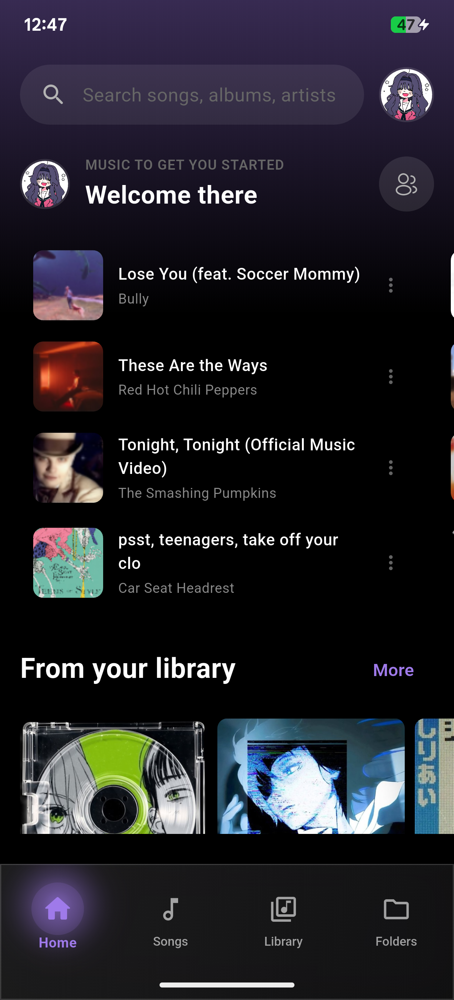 | 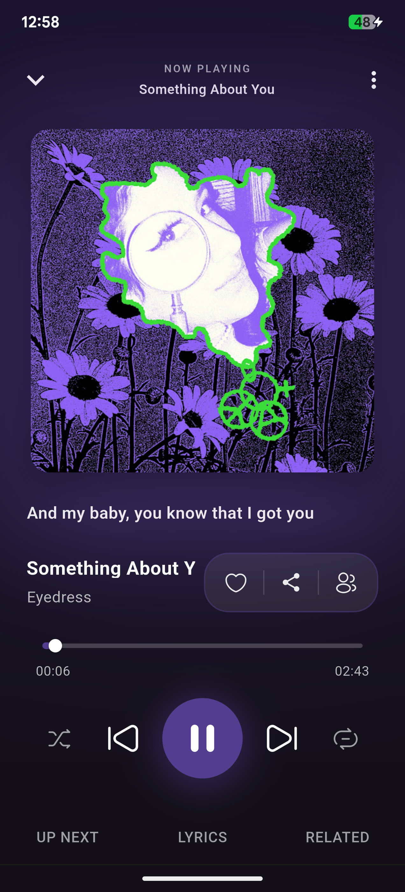 | 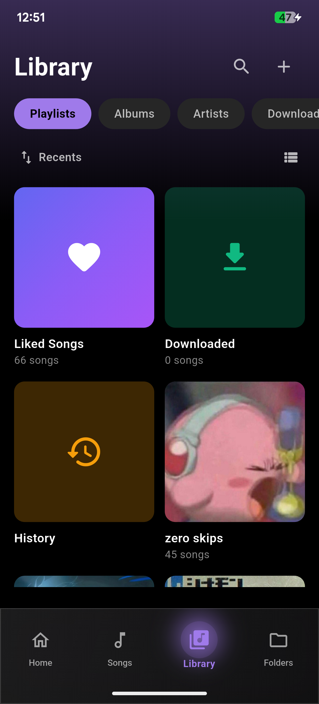 | 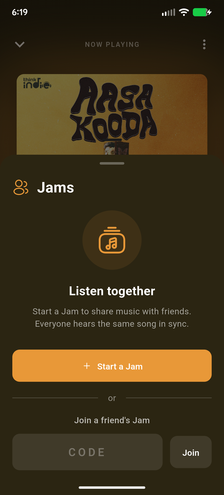 |
| **Search** | **Playlist** | **Folders** | **Lyrics** |
| 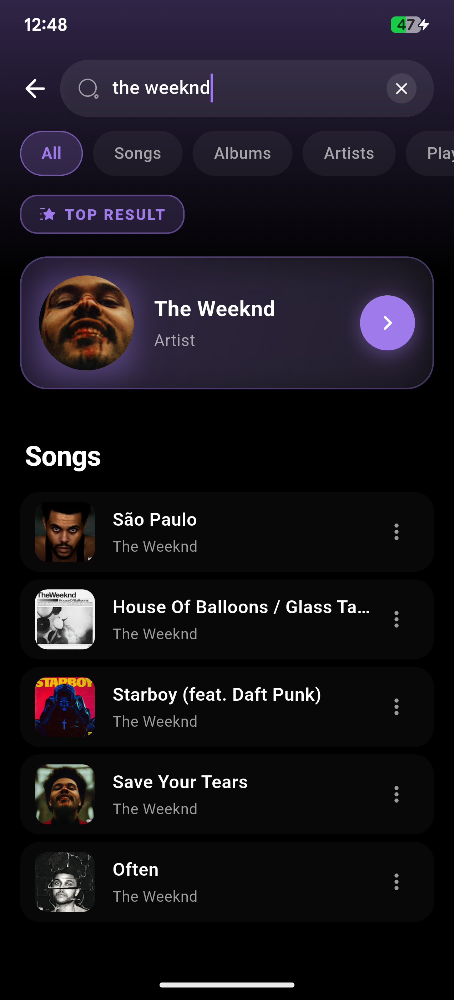 | 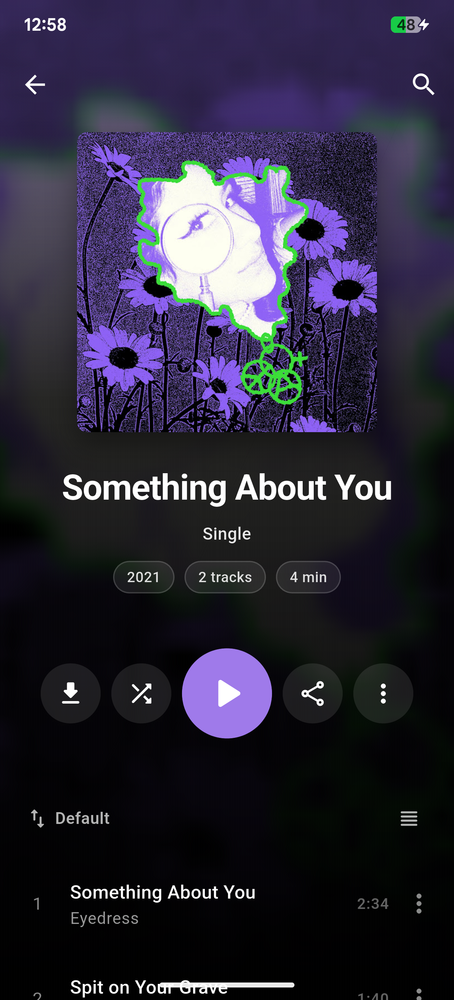 | 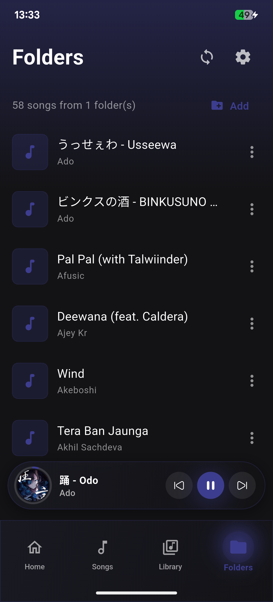 | 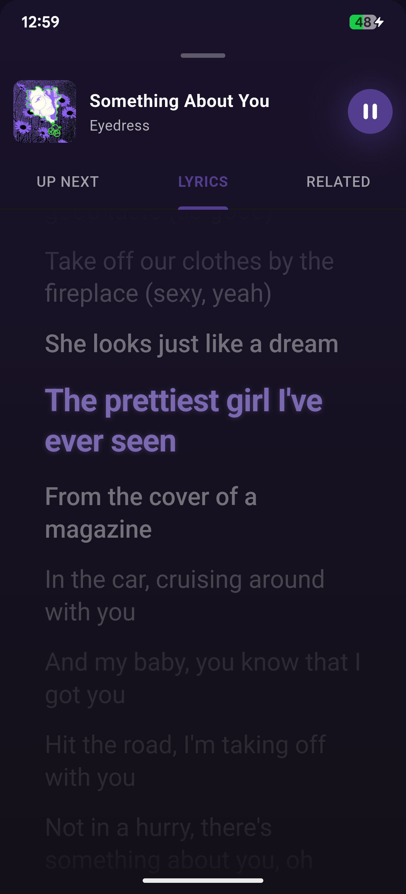 |

</div>

<table width="100%">
<tr><th align="center">Word-Level Synced Lyrics</th></tr>
<tr><td align="center">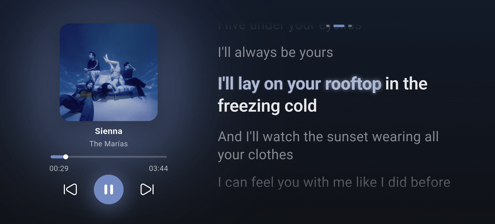</td></tr>
</table>

<div align="center">

| **Widget 4×1** | **Widget 4×2** |
|:---:|:---:|
| 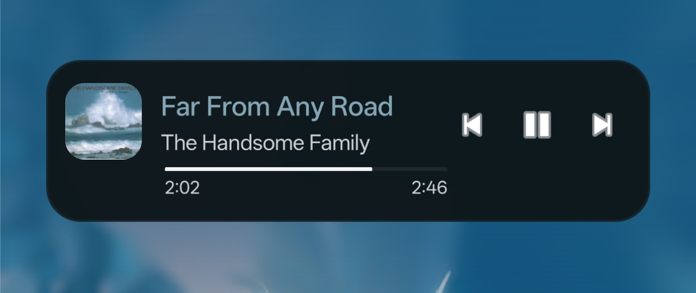 | 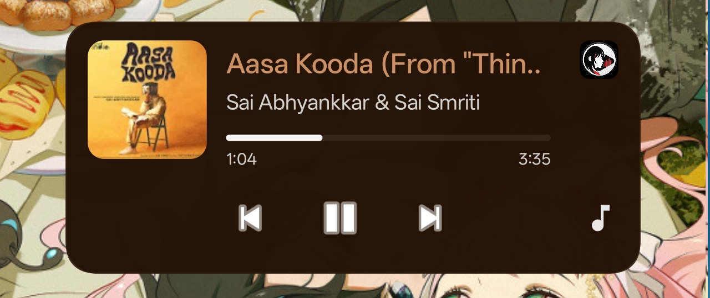 |

| **Android Auto** | **Android Auto — Now Playing** |
|:---:|:---:|
| 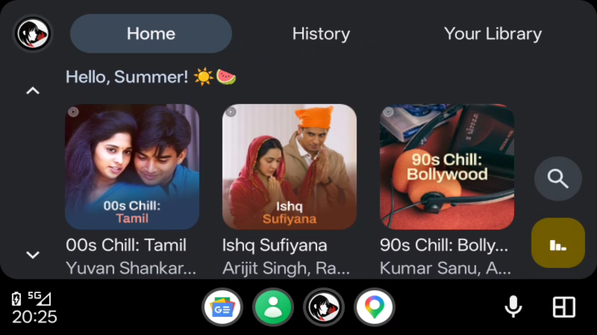 | 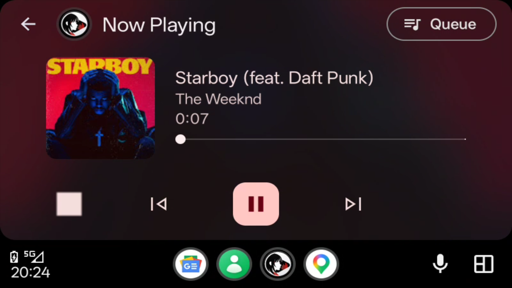 |

</div>

---

## 📥 Installation

Inzx supports **Android**. Grab the latest APK one of two ways:

- **Obtainium** (recommended) — auto-updates directly from GitHub releases. Use the badge above or add this repo:
  `https://github.com/nirmaleeswar30/Inzx`
- **GitHub Releases** — download the APK from the [latest release](https://github.com/nirmaleeswar30/Inzx/releases/latest).

Once installed, Inzx delivers smaller patches automatically via over-the-air (OTA) updates, so you stay current without reinstalling.

<details>
<summary>Install via ADB</summary>

```bash
adb install app-release.apk
```
</details>

---

## 🛠️ Building from Source

### Prerequisites
- **Flutter SDK** (stable channel, bundling **Dart**)
- **Android Studio** or **VS Code** with the Flutter/Dart extensions
- **Android SDK** and **Git**

### Setup

1. **Clone the repository**
   ```bash
   git clone https://github.com/nirmaleeswar30/Inzx.git
   cd Inzx
   ```

2. **Install dependencies**
   ```bash
   flutter pub get
   ```

3. **Run code generation**
   ```bash
   dart run build_runner build --delete-conflicting-outputs
   flutter gen-l10n
   ```

4. **Configure environment variables** — copy the example and fill in the values:
   ```bash
   cp .env.example .env
   ```
   | Variable | Purpose |
   |---|---|
   | `SUPABASE_URL` / `SUPABASE_ANON_KEY` | Real-time backend for **Jams** |
   | `GOOGLE_WEB_CLIENT_ID` | Google Sign-In for Jam profiles |
   | `GITHUB_RELEASE_REPO` | Repo checked for GitHub release updates |

   > Jams and Google Sign-In are optional — the rest of the app builds and runs without them.

5. **(Optional) Configure Supabase** for Jams — create a project at [supabase.com](https://supabase.com), enable Realtime, and paste the URL and anon key into `.env`.

6. **(Optional) Configure Google Sign-In** — create an OAuth 2.0 Web Client ID in the Google Cloud Console and set `GOOGLE_WEB_CLIENT_ID`.

### Build Commands

```bash
# Debug run
flutter run

# Release APK
flutter build apk --release

# Split APKs per ABI (smaller downloads)
flutter build apk --split-per-abi --release
```

---

## 🏗️ Architecture & Tech Stack

**Core** — Flutter · Dart · [Riverpod](https://riverpod.dev) (state management)

**Data & storage** — [Hive](https://pub.dev/packages/hive) (fast local cache for tracks, playlists & colors) · Flutter Secure Storage (encrypted credentials) · Shared Preferences (settings) · [Supabase](https://supabase.com) (real-time Jams backend)

**Audio & catalog** — Custom **InnerTube API** engine · [just_audio](https://pub.dev/packages/just_audio) · [audio_service](https://pub.dev/packages/audio_service) (background/media controls) · [audio_session](https://pub.dev/packages/audio_session) · JioSaavn HQ source (DES-decrypted stream URLs)

**UI & media** — [Skeletonizer](https://pub.dev/packages/skeletonizer) · isolate-based `AlbumColorExtractor` (0 ms palette) · [Iconsax](https://pub.dev/packages/iconsax) · Cached Network Image · `video_player` (Canvas art) · Marquee

**Delivery** — [Shorebird](https://shorebird.dev) code push for OTA updates

---

## 🌍 Localization

Inzx ships a fully localized UI and locale-aware YouTube Music content requests in **20+ languages**:

English · Arabic · German · Spanish · French · Hindi · Indonesian · Japanese · Kannada · Korean · Malayalam · Portuguese · Portuguese (Brazil) · Russian · Tamil · Telugu · Thai · Turkish · Ukrainian · Simplified Chinese · Traditional Chinese

Translations live in [`lib/l10n`](lib/l10n). Contributions and corrections are very welcome — see [Contributing](#-contributing).

---

## 🗺️ Roadmap

- [x] Word-level synced lyrics (BetterLyrics TTML engine)
- [x] AI lyric translation & transliteration
- [x] JioSaavn high-quality audio source
- [x] Crossfade & gapless prefetching
- [x] Android Auto
- [x] Home-screen widgets
- [x] Multiple Now Playing & progress-bar styles
- [x] Over-the-air updates (Shorebird)
- [ ] Chromecast / cast to external speakers
- [ ] Desktop targets (Windows · macOS · Linux)

---

## 🤝 Contributing

Contributions are welcome! Bug reports, feature ideas, translations and pull requests all help.

1. Fork the repo and create a branch off `main`.
2. Make your changes and run `flutter analyze` (keep it clean).
3. Open a pull request describing what and why.

For larger features, please open an issue first so we can align on the approach.

---

## 🙏 Acknowledgments

- [OuterTune](https://github.com/OuterTune/OuterTune) & [InnerTune](https://github.com/z-huang/InnerTune) — design and architecture inspiration
- [BetterLyrics](https://github.com/boidushya/better-lyrics) — word-level synced lyrics
- [LRCLib](https://lrclib.net) — open synced-lyrics database
- [Metrolist](https://github.com/metrolistgroup/metrolist) — Kotlin based ytm client
- [Bitchord](https://github.com/kushagrasinghx/BitChord) — another kotlin ytm client built on top of metrolist
- [just_audio](https://pub.dev/packages/just_audio) — audio playback engine
- [Supabase](https://supabase.com) — real-time infrastructure
- [Shorebird](https://shorebird.dev) — Flutter over-the-air updates
- [Flutter](https://flutter.dev) — UI framework

---

## ⭐ Star History

<a href="https://star-history.com/#nirmaleeswar30/Inzx&Date">
  <picture>
    <source media="(prefers-color-scheme: dark)" srcset="https://api.star-history.com/svg?repos=nirmaleeswar30/Inzx&type=Date&theme=dark" />
    <source media="(prefers-color-scheme: light)" srcset="https://api.star-history.com/svg?repos=nirmaleeswar30/Inzx&type=Date" />
    
  </picture>
</a>

---

## 📄 License

Released under the [MIT License](LICENSE).

